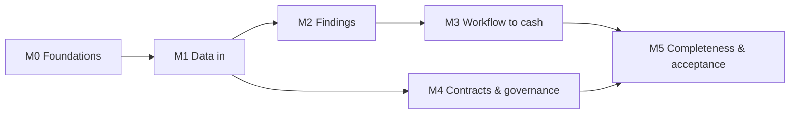

# JADAssure — Build Plan (pilot)

## ⏵ Resume here

*Updated 2026-10-30, end of session 10.*

- **Agentic AI started (decision 0009).** BE-034 + FE-010 are Built: an Assistant panel on every
  screen. Claude looks things up with tools limited to the user's role; every change it suggests is
  a card that runs only on the user's Confirm, re-checked against their role and the record's state
  (new guardrail GR-17). Since BE-031, BE-033 (user name/email correction) is also Built.
- **To try it:** add `ANTHROPIC_API_KEY` to `.env`, `docker compose up -d`, then as admin choose
  Claude in Access & settings (RUNNING.md). Without a key the panel explains what's needed.
  Browser-checked without a key: prepared-action card rendered, confirmed, overview refreshed.
  The full Claude loop is covered by `tests/test_assistant.py` with a scripted model, but has not
  yet run against the real API.
- **Owner checkpoints pending:** M0–M5, plus BE-033, BE-034, FE-010. Nothing is Done until the owner
  promotes it.
- **Live site:** Render Blueprint still to be applied by the owner (docs/deployment.md).
- **Exact next action (agent):** BE-035 investigation agent, then BE-036 triage agent, then BE-037
  onboarding agent, each on the prepared-action pattern.

## Handoff protocol

**Session start**
1. Read `AGENTS.md`, then this "Resume here" block.
2. Open `docs/jadassure-task-board.csv`, find the row you'll touch, and **quote its Acceptance
   Criteria** before implementing.

**Before substantive edits**
3. Set the row to `In Progress` with your name in Assignee, and update "Resume here".

**Session end**
4. Mark finished work `Built`, never `Done`.
5. Rewrite "Resume here": what works, what's half-done, the exact next step.
6. Make sure the tests you touched pass. For UI work, verify in a real browser.
7. Append to the progress log below.

## Milestones

Each milestone ends with a **manual checkpoint the owner runs**. The agent builds up to the
checkpoint, the owner tries it, and then both move on.

### M0: Foundations
INFRA-001, INFRA-002, INFRA-003, BE-001, BE-002, BE-003, BE-004, FE-001
**Checkpoint:** `docker compose up` works. `/api/health` is green. Log in to the UI as a newly
signed-up admin and see the navigation shell.

### M1: Data in
BE-005, BE-006, BE-008, BE-007, BE-011, BE-009, DATA-001, FE-002
**Checkpoint:** seed the demo orgs. As admin, import a demo CSV through the UI, see the profile and
results, re-import the same file and see zero inserts.

### M2: Findings
BE-012, BE-013, BE-014…BE-018, BE-019, BE-010, BE-020, FE-003, FE-004 (read-only part)
**Checkpoint:** click "Run checks now" and see findings for unbilled delivery, wrong rate and
expired discount with correct values and evidence. Run again: no duplicates.

### M3: Workflow to cash
BE-021, BE-022, BE-023, BE-025, FE-004 (actions), FE-005, FE-006
**Checkpoint:** walk scenario 6 (propose → approve → billed → cash) and scenario 5 (reject).
Overview figures move correctly. A proposer can't approve their own finding.

### M4: Contracts and governance
BE-027, BE-028, BE-029, BE-030, BE-032, FE-007, FE-009
**Checkpoint:** upload the demo contract, see the ambiguous term held, confirm it and re-run.
Audit verify passes. A user from another org can't see findings.

### M5: Completeness and acceptance
BE-024, BE-026, BE-031, FE-008, QA-001, DOC-001, DOC-002
**Checkpoint:** the automated acceptance test passes all eight scenarios. The owner follows
`docs/walkthrough.md` end to end.

## Sequencing

## Working rules

- One task at a time, in milestone order.
- Fix integration friction before starting the next milestone.
- Don't pile up known-broken steps. A red test blocks the next task.
- A checkpoint isn't passed until the owner has run it.

## Progress log

| Date | Session | Summary |
|---|---|---|
| 2026-10-26 | 1 | Repo created (JADA-Squad/JADAssure, private). Phase 0: requirements (42 FR / 16 GR / 12 NFR), solution design, executive summary, AGENTS.md, task board (48 tasks, all requirement IDs traced both ways), decision 0001, RUNNING.md, this plan. Docker engine not running on dev machine; noted. |
| 2026-10-26 | 2 | M0 built: Compose stack (db on host 5433 because a local Postgres holds 5432), health endpoint with worker heartbeat, Alembic + canonical model migration (26 tables), pytest harness on a throwaway Postgres DB, AI import-boundary test, signup/login/JWT, permission matrix with route-coverage test, tenant scoping, hash-chained audit with verify, React shell with login/signup and role-aware nav. Fixes along the way: alembic `prepend_sys_path`, circular `rule`↔`rule_version` FK moved to `create_foreign_key`, `.test` emails rejected by validator. Added "view agreements" row to design §3.7. All M0 rows Built. |
| 2026-10-26 | 3 | M1: field registry + templates; data sources, mapping (saved per source, header/synonym suggestions), profiling, idempotent commit with formula-safe error reports; Postgres job queue + worker with retry; agreements API and the single confirmed-terms query; connector interface + DEMO connector (one-transaction syncs); generated demo datasets for three business types with documented expected findings; seed command and opt-in demo-login panel; Data setup screen. Decision 0002 recorded. Fixes: registry→model attr mismatch caught by test (`version_id`), login page flashed before session restore, demo panel/split layout overflow at narrow widths. FE-002 and DATA-001 remain In Progress (need M2). |
| 2026-10-26 | 4 | M2: versioned rule configs with business-type defaults; TermBook (equivalent to resolve_terms); matcher buckets; five checks with one-finding-per-line total-shortfall valuation; fingerprint upsert with freeze-once-proposed; check runs as jobs with one-at-a-time guard and worker-side schedule; findings queue/detail/comments API; Findings queue and detail screens; Run checks now on Data setup and Findings. Demo data yields exactly the planted findings across all three business types (asserted in tests and seen in the dev DB). Decision 0003 recorded. Fixes: rule-param decimal normalization ("5" vs "5.00" made a new version), JSONB key order in calculation display, money cells wrapping. |
| 2026-10-26 | 5 | UI retheme to #E85E08 with black/white (AA contrast kept: black text on orange, #B84A06 for orange text). Render deployment: root multi-stage Dockerfile, render.yaml (web + Postgres, auto-deploy from main), embedded worker thread, SPA served by FastAPI, postgres:// URL normalization, public-safe defaults (no demo-account listing, no signup), docs/deployment.md (DOC-002 Built), decision 0004. Verified the production image end to end locally with a Render-style environment. |
| 2026-10-26 | 6 | Demo orgs renamed per owner: **JM** (professional-services + subscription datasets via two demo connector sources) and **Beyon** (distribution). Logins are role-based on each org's domain (admin@, financeanalyst@, financeapprover@, commercialmanager@, executive@ + jm.com / beyon.com). Seed gained `--remove-obsolete` (demo-flagged orgs only; used by start.sh on Render). DATA-001 acceptance wording updated; decision 0005. Verified: dev DB reseeded (old demo orgs removed, non-demo org kept), JM analyst sees 6 findings totalling 4,530.00 USD. |
| 2026-10-26 | 7 | M3: workflow per design §2.5 with row locks, separation of duties and server-computed available actions; terminal-state immutability trigger; root-cause categories; prepared corrections (JA-<org>-0001) with CSV/JSON export; recovery reconcile (billed from referenced invoices, cash only from allocations to them, capped, idempotent) queued after imports; DEMO-only billing/payment simulation; six outcome figures + trend + root causes API; finding actions panel, Recovery tracker and Overview (emphasis chart after palette validation rejected orange+black). Fixes: same-transaction timeline order (clock_timestamp), Postgres GROUP BY with bound to_char format, missing accessible names on action forms. Decision 0006. |
| 2026-10-26 | 8 | M4: contract upload (PDF/DOCX/TXT, signature checks, sha256, DocumentStore, text extraction); AI provider interface with offline stub default and Claude adapter (claude-opus-5-5, structured output, fallbacks) behind an audited opt-in + key; proposed-term extraction with verbatim-passage verification and ambiguity flags; confirm/edit/reject with audit; settings (schedule, provider, retention purge) and org data deletion with tombstone; Rules & agreements and Access & settings screens; Orchard demo hours for scenario 4. Fixes: alembic constraint double-prefix, transient Windows file lock during scripted edits (retry), stale container env for ANTHROPIC_MODEL (recreate, not restart), users table overflow. Decision 0007. |
| 2026-10-26 | 9 | M5: recurrence flagged at check-run time and a prevented-recurrence estimate on Overview; pricing opportunities from confirmed contract price vs cost with a configurable target margin; AI mapping suggestions (deterministic value evidence first, provider second, filtered, never auto-applied) and labelled, audited finding summaries; QA-001 acceptance test for all eight scenarios with NFR-04 timing; docs/walkthrough.md. Fixes found in the browser: two quick Apply clicks lost one mapping (stale state, now functional updates); after sign-out the next user landed on the previous user's page; unit prices shown as 12.5. Decision 0008. |
| 2026-10-30 | 10 | Agentic assistant (BE-034, FE-010): role-scoped tool registry over the existing services, bounded Claude tool-use loop via `AnthropicProvider.converse`, write tools that only prepare `assistant_action` rows, confirm/cancel endpoints that re-check role and state in a savepoint, audited without chat text; panel with action cards on every screen. FR-43–FR-46, GR-17, decision 0009, migration 0006; engine domains barred from importing `assistant`. Roadmap rows BE-035–BE-037 in Backlog. Earlier in the session: BE-033 user name/email correction, demo renames to JM/Beyon, seed `--reset`, JM demo script. |
