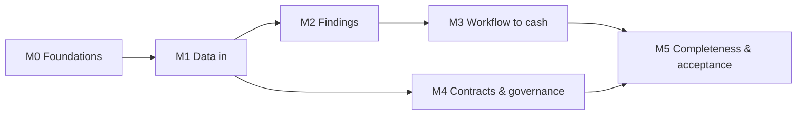

# JADAssure — Build Plan (pilot)

## ⏵ Resume here

*Updated 2026-10-26, end of session 2.*

- **Done (Built, awaiting owner checkpoint):** all of **M0**: INFRA-001..003, BE-001..004, FE-001.
  The stack runs with `docker compose up -d --build`. 71 backend tests pass, and the frontend
  type-checks and builds. The agent ran the checkpoint in a browser: signup → Overview, role-filtered
  nav for admin and executive, session survives reload, direct URL to a forbidden area is blocked,
  1280px layout correct.
- **In flight:** nothing.
- **Owner action:** run the **M0 checkpoint** below yourself, then promote the M0 rows to Done on
  the task board (or report what's wrong).
- **Exact next action (agent):** start **M1** with **BE-005** (field registry + CSV templates), then
  BE-006 → BE-008 → BE-007 → BE-011 → BE-009 → DATA-001 → FE-002.

## Handoff protocol

**Session start**
1. Read `AGENTS.md`, then this "Resume here" block.
2. Open `docs/jadassure-task-board.csv`, find the row you'll touch, and **quote its Acceptance
   Criteria** before implementing.

**Before substantive edits**
3. Set the row to `In Progress` with your name in Assignee, and update "Resume here".

**Session end**
4. Mark finished work `Built`, never `Done`.
5. Rewrite "Resume here": what works, what's half-done, the exact next step.
6. Make sure the tests you touched pass. For UI work, verify in a real browser.
7. Append to the progress log below.

## Milestones

Each milestone ends with a **manual checkpoint the owner runs**. The agent builds up to the
checkpoint, the owner tries it, and then both move on.

### M0: Foundations
INFRA-001, INFRA-002, INFRA-003, BE-001, BE-002, BE-003, BE-004, FE-001
**Checkpoint:** `docker compose up` works. `/api/health` is green. Log in to the UI as a newly
signed-up admin and see the navigation shell.

### M1: Data in
BE-005, BE-006, BE-008, BE-007, BE-011, BE-009, DATA-001, FE-002
**Checkpoint:** seed the demo orgs. As admin, import a demo CSV through the UI, see the profile and
results, re-import the same file and see zero inserts.

### M2: Findings
BE-012, BE-013, BE-014…BE-018, BE-019, BE-010, BE-020, FE-003, FE-004 (read-only part)
**Checkpoint:** click "Run checks now" and see findings for unbilled delivery, wrong rate and
expired discount with correct values and evidence. Run again: no duplicates.

### M3: Workflow to cash
BE-021, BE-022, BE-023, BE-025, FE-004 (actions), FE-005, FE-006
**Checkpoint:** walk scenario 6 (propose → approve → billed → cash) and scenario 5 (reject).
Overview figures move correctly. A proposer can't approve their own finding.

### M4: Contracts and governance
BE-027, BE-028, BE-029, BE-030, BE-032, FE-007, FE-009
**Checkpoint:** upload the demo contract, see the ambiguous term held, confirm it and re-run.
Audit verify passes. A user from another org can't see findings.

### M5: Completeness and acceptance
BE-024, BE-026, BE-031, FE-008, QA-001, DOC-001, DOC-002
**Checkpoint:** the automated acceptance test passes all eight scenarios. The owner follows
`docs/walkthrough.md` end to end.

## Sequencing

## Working rules

- One task at a time, in milestone order.
- Fix integration friction before starting the next milestone.
- Don't pile up known-broken steps. A red test blocks the next task.
- A checkpoint isn't passed until the owner has run it.

## Progress log

| Date | Session | Summary |
|---|---|---|
| 2026-10-26 | 1 | Repo created (JADA-Squad/JADAssure, private). Phase 0: requirements (42 FR / 16 GR / 12 NFR), solution design, executive summary, AGENTS.md, task board (48 tasks, all requirement IDs traced both ways), decision 0001, RUNNING.md, this plan. Docker engine not running on dev machine; noted. |
| 2026-10-26 | 2 | M0 built: Compose stack (db on host 5433 because a local Postgres holds 5432), health endpoint with worker heartbeat, Alembic + canonical model migration (26 tables), pytest harness on a throwaway Postgres DB, AI import-boundary test, signup/login/JWT, permission matrix with route-coverage test, tenant scoping, hash-chained audit with verify, React shell with login/signup and role-aware nav. Fixes along the way: alembic `prepend_sys_path`, circular `rule`↔`rule_version` FK moved to `create_foreign_key`, `.test` emails rejected by validator. Added "view agreements" row to design §3.7. All M0 rows Built. |
