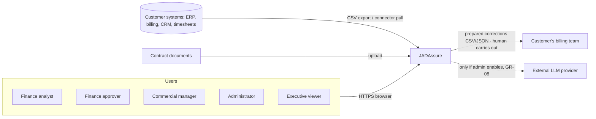
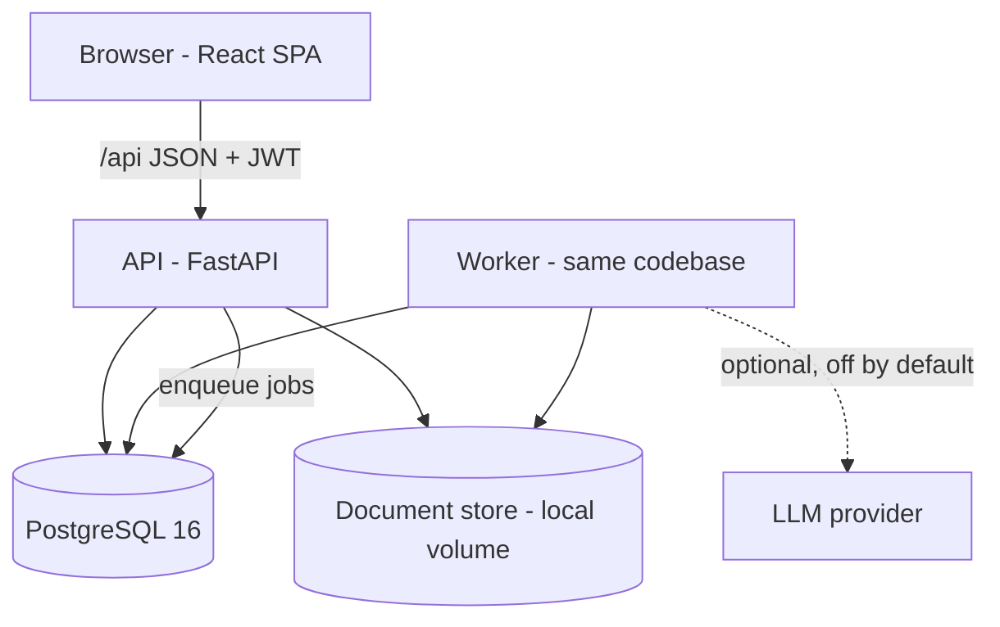
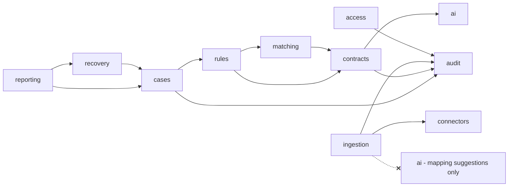
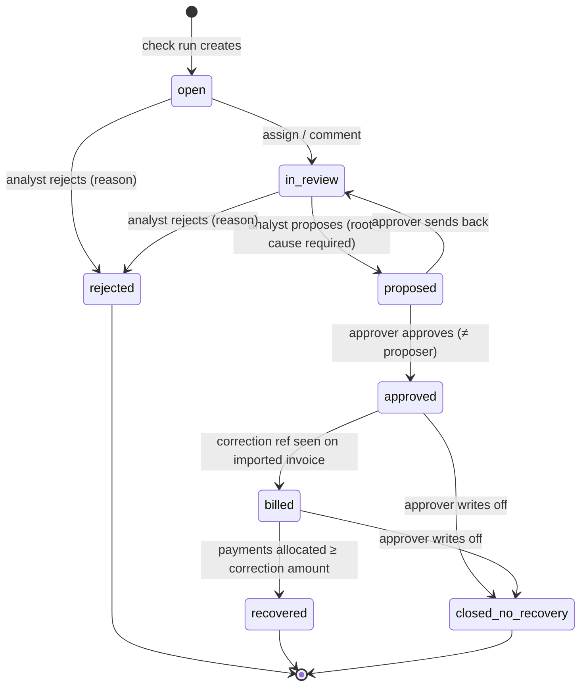
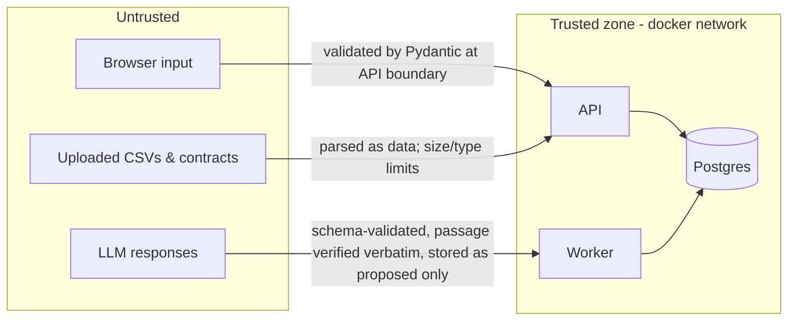

# JADAssure — Solution Design (Pilot / Release 1)

| | |
|---|---|
| Version | 0.1 |
| Date | 2026-10-26 |
| Requirements | `docs/jadassure-requirements.md` (FR/GR/NFR IDs referenced throughout) |
| Decisions | `docs/decisions/0001-jadassure-build-decisions.md` |

This is the working design. It's short enough (<500 lines) that no condensed version is needed.

---

## 1. Solution overview

**Proposed capability.** JADAssure is a multi-organization revenue assurance application. It
ingests agreed, delivered, billed and collected records into one canonical model, runs
deterministic checks, and manages each discrepancy from finding to verified cash recovery.

**Scope.** Requirements §3.1. Deferred items are in requirements §3.2.

**Success measures (pilot).** All eight acceptance scenarios pass in the UI and in the automated
E2E test. No duplicate findings across re-runs. No cross-organization access. Every finding value
can be reproduced from its stored calculation.

**Design assumptions.** Requirements §12 (A1–A5). In addition, the pilot runs on one Postgres
instance and one worker process; nothing in the design prevents scaling either.

---

## 2. High-level design

### 2.1 Core decisions (the choices that shape everything else)

| # | Decision | Consequence |
|---|---|---|
| C1 | **Deterministic engine, AI at the edges.** AI may only *propose* (terms, mappings, summaries). The engine reads confirmed terms and versioned rules; it has no import path to the AI module. | GR-02/GR-03 are enforced structurally: an import-linter test fails the build if `rules`/`matching` import `ai`. |
| C2 | **Canonical model + source pointer.** Every canonical record keeps `(data_source_id, source_record_id, source_payload, source_hash, import_id)`. A unique key on `(org_id, data_source_id, record_type, source_record_id)` makes re-import an upsert. | Idempotent imports (FR-08, GR-11), full lineage (GR-16). |
| C3 | **Finding fingerprint.** A finding's identity is `sha256(org, family, anchor_type, anchor_id)`. *Family* groups checks that describe the same underlying money: `unbilled` (anchor: billing-period bucket), `price` (anchor: invoice line), `credit` (anchor: credit). The most specific check in a family wins; others are recorded as `also_detected_by`. | One finding per discrepancy across checks and runs (FR-23). |
| C4 | **Evidence snapshot.** When a finding is created or refreshed, it stores an immutable JSON snapshot of every source record, term, rule version and calculation used. | Later re-imports can't rewrite history (GR-13, GR-16). |
| C5 | **Explicit state machine** for findings with a fixed mapping from status to reporting bucket. | Correct, non-overlapping outcome figures (FR-32, GR-04, GR-05). |
| C6 | **Tenant scoping in one layer.** The org comes from the authenticated token only, never from request input. All data access goes through `scoped(session, ctx)` repository helpers that add `org_id` filters. | GR-06, with tests that attempt cross-org access on every router. |
| C7 | **Postgres-backed job queue** (`SELECT … FOR UPDATE SKIP LOCKED`) instead of Redis/Celery. | One fewer service; failed jobs are visible rows with retry (FR-11). |
| C8 | **Hash-chained audit log** per org: `hash = sha256(prev_hash ‖ canonical_json(event))`. | Tamper-evident (GR-10); a verify endpoint recomputes the chain. |

### 2.2 System context



### 2.3 Containers



| Container | Responsibility |
|---|---|
| `web` | React SPA (Vite dev server locally, proxies `/api` to `api`) |
| `api` | REST API, auth, validation, synchronous profiling, enqueues jobs, OpenAPI at `/api/docs` |
| `worker` | Runs jobs: import commit, check runs, term extraction, connector sync, scheduled refresh |
| `db` | All structured data, job queue, audit log |
| document store | Original uploaded contracts and import files (interface; local filesystem in pilot) |

### 2.4 Components (backend domains)



| Domain | Owns | Must never |
|---|---|---|
| `access` | orgs, users, roles, auth, permission checks | trust an org id from request input |
| `audit` | hash-chained audit events, verify | allow update/delete of events |
| `ingestion` | data sources, mappings, templates, profiling, import commit, canonical upserts | write findings |
| `connectors` | connector interface, demo connector | present demo as live (GR-14) |
| `contracts` | agreements, versions, terms, documents, term confirmation | let a non-confirmed term reach the engine |
| `ai` | provider interface, stub + Anthropic adapters, prompt hardening | be imported by `matching`/`rules`/`cases`/`recovery`/`reporting` |
| `matching` | delivered vs billed aggregation, term resolution for a date | use floats |
| `rules` | rule configs + versions, the five checks, finding generation and dedup | read AI output |
| `cases` | finding workflow, comments, approvals, corrections | allow self-approval or edits after terminal states |
| `recovery` | billed/cash matching for corrections, root cause, recurrence | count unpaid invoices as cash |
| `reporting` | outcome figures, trends, pricing opportunities | mix opportunities into leakage figures |

### 2.5 Finding lifecycle



Reporting buckets (FR-32). Each figure is computed independently, never derived from another:

| Figure | Definition |
|---|---|
| Potential leakage | Σ value of findings in `open`, `in_review`, `proposed` |
| Confirmed leakage | Σ value of findings in `approved`, `billed`, `recovered`, `closed_no_recovery` |
| Corrected billing | Σ net amount of imported invoice lines on invoices carrying a correction reference |
| Cash recovered | Σ per correction of min(payment allocations to its invoice(s), correction amount) |
| Prevented recurrence (estimate) | Σ per approved finding of per-period value × later billing periods checked with no recurrence |
| Closed without recovery | Σ value of findings in `closed_no_recovery` |

Rejected findings appear only as a count ("rejected as not leakage") and never in any money
figure (GR-05).

### 2.6 Deployment and trust boundaries



Locally everything runs in Docker Compose. For production (deferred), the guide requires TLS
termination at the edge, encrypted Postgres storage and volumes, and secrets from a secrets manager
(NFR-06).

---

## 3. Detailed design

### 3.1 End-to-end workflow

1. **Org setup.** `POST /api/orgs/signup` creates an org + admin (FR-01). The admin creates users (FR-02).
2. **Data source.** The admin registers a source (type `csv` or `connector:demo`) (FR-05, FR-09).
3. **Import.** Upload CSV → API stores the file, applies the saved mapping or suggests one (FR-39)
   → **profile** response (FR-06) → admin confirms the mapping → commit job (FR-07). The worker
   validates rows, upserts canonical records (FR-08), writes the error report and an audit event.
4. **Contracts.** Upload a document → extraction job → proposed terms with passages (FR-13) →
   a commercial manager or admin confirms, edits or rejects them (FR-14).
5. **Check run.** "Run checks now" or the scheduler enqueues `run_checks` (FR-10). The worker loads
   the active rule version, runs the matcher and five checks, then upserts findings by fingerprint
   (FR-16 to FR-24).
6. **Case work.** Analyst: assign, comment, propose with root cause, or reject (FR-27). Approver:
   approve or send back (FR-28). Approval creates a prepared correction with reference
   `JA-<org short>-<seq>` (FR-29).
7. **Recovery.** Later imports: an invoice with `correction_reference` moves the finding to
   `billed`; payment allocations against that invoice move it to `recovered` (FR-30).
8. **Recurrence.** Each run compares new findings with prior approved findings on the same
   recurrence key `(customer, agreement, family, item)` and flags recurrences. Clean periods count
   toward prevented recurrence (FR-31).

### 3.2 Canonical data model

Every table below has `id (uuid)`, `org_id (uuid, FK, indexed)`, `created_at`, `updated_at`.
Source-backed tables (marked †) also have `data_source_id`, `source_record_id`, `source_payload jsonb`,
`source_hash`, `import_id`, with `UNIQUE(org_id, data_source_id, source_record_id)`. Money columns
are `NUMERIC(19,4)` paired with a `currency CHAR(3)` (GR-09, NFR-05).

| Entity | Key columns |
|---|---|
| organization | name, short_code, business_type, settings jsonb (refresh interval, retention days, ai_provider, materiality), is_demo |
| user | email, password_hash, role (`admin`,`analyst`,`approver`,`commercial`,`executive`), active |
| data_source | name, kind (`csv`,`connector`), connector_key, is_demo, mapping jsonb per record type |
| import_batch | data_source, record_type, file_ref, status, counts (inserted/updated/unchanged/rejected), error_report_ref, profile jsonb |
| customer † | name, currency |
| agreement † | customer, title, start_date, end_date, billing_frequency (`monthly`,`quarterly`,`annual`,`per_event`,`milestone`), currency, document_id |
| agreement_version † | agreement, version_no, effective_from, effective_to, reason |
| commercial_term † | agreement_version, item_code, term_type (`rate`,`discount`,`escalation`,`credit_policy`,`minimum`), value, unit, effective_from, effective_to, approval_ref, status (`proposed`,`confirmed`,`rejected`), ambiguous bool, source_passage, origin (`import`,`extraction`,`manual`), confirmed_by, confirmed_at |
| billable_event † | customer, agreement (nullable), item_code, quantity NUMERIC(19,6), unit, service_date, billing_date, currency |
| invoice † | customer, number, invoice_date, currency, status, correction_reference |
| invoice_line † | invoice, item_code, quantity, unit_price, discount_pct, net_amount, tax_amount, service_period_start/end, agreement (nullable) |
| credit † | customer, invoice (nullable), amount, currency, reason_code, approval_ref, credit_date |
| payment † | customer, amount, currency, payment_date |
| payment_allocation † | payment, invoice, amount |
| cost_record † | item_code, unit_cost, currency, effective_from, effective_to |
| document | filename, media_type, storage_key, sha256, uploaded_by, text_extracted |
| rule | check_type, active_version_id |
| rule_version | rule, version_no, params jsonb (tolerance, grace_days, approval_threshold, max_credit, discount rules), created_by |
| check_run | trigger (`manual`,`schedule`), status, rule_version_ids jsonb, stats jsonb, error |
| finding | fingerprint UNIQUE(org), family, check_type, also_detected_by[], customer, agreement, item_code, period, value, currency, confidence, reason, calculation jsonb, evidence jsonb (snapshot), rule_version_id, recommended_action, status, owner_id, proposer_id, root_cause, recurrence_of_id, first_run_id, last_run_id, ai_summary |
| investigation_event | finding, actor, kind (`comment`,`assign`,`status`), body, at |
| approval | finding, approver, decision, note, at |
| correction | finding, reference UNIQUE, kind, lines jsonb, amount, currency, status (`prepared`,`billed`,`paid`,`partially_paid`), matched_invoice_ids |
| recovery_event | correction, kind (`billed`,`cash`), amount, source record ref, at |
| job | kind, payload jsonb, status, attempts, last_error, run_after |
| audit_event | seq, actor, action, entity, entity_id, payload jsonb, prev_hash, hash |

### 3.3 Ingestion and consistency

- **Templates.** One CSV template per record type, generated from the same field registry that
  drives validation (FR-04). There is only one definition of each field.
- **Mapping.** Stored per data source per record type. Suggestions come from exact/normalized
  header matching, or from the AI provider when enabled (FR-39). They are always suggestions.
- **Profiling.** Required-field coverage per column, unparseable values, unmatched foreign
  references (resolved against existing canonical records plus records in the same batch).
- **Commit.** One row at a time inside batched transactions. A row is valid → upsert by source key:
  `inserted`, `updated` (hash changed) or `unchanged`. Invalid rows go to the error report.
  Order of record types in a multi-file load is dependency order (customer → agreement → … →
  payment_allocation).
- **Safe reprocessing.** Re-running an import replays the same upserts. Findings are untouched
  until the next check run, which upserts by fingerprint. A finding in a terminal state is never
  reopened or revalued (GR-13).

### 3.4 Matching and checks (deterministic)

**Term resolution.** `resolve_terms(agreement, item_code, on_date)` returns the confirmed terms
of the agreement version effective on that date, filtered by each term's own effective range
(FR-12). Only `status='confirmed'` terms are ever loaded: the query lives in one function and a
test asserts it (GR-03).

**Billing periods.** Derived from `billing_frequency`: monthly / quarterly / annual calendar
periods; `per_event` uses the event's own date; `milestone` uses the event's billing_date.

**Matcher (FR-16).** Groups billable events and invoice lines into buckets
`(customer, agreement, item_code, billing_period, currency)`. Invoice lines map to a bucket by
explicit agreement reference, or else by customer + item + service period. Split invoices and
aggregated lines are handled naturally because quantities are summed per bucket. Partial delivery
is fine because only delivered quantity creates expectation.

| Check | Family | Fires when | Value |
|---|---|---|---|
| delivered_not_billed (FR-17) | unbilled | bucket delivered qty − billed qty > 0 and today > billing_date + grace_days | missing qty × expected net unit price |
| incorrect_rate (FR-18) | price | abs(line net unit price − expected net unit price) > tolerance | (expected − actual) × qty |
| expired_discount (FR-19) | price | line discount > 0 and (no discount term effective on service date, or discount > approved %) | (expected net − actual net) × qty |
| missed_increase (FR-20) | price | escalation term effective on service date and the line's unit price equals the pre-escalation rate | (escalated − billed) × qty |
| credit_outside_policy (FR-21) | credit | missing reason code; or amount > approval_threshold without approval_ref; or amount > max_credit | full credit amount (or excess over the limit) |

Expected net unit price = confirmed rate (after escalations effective on the date) × (1 −
authorized discount effective on the date). All arithmetic uses `decimal.Decimal` with explicit
quantization to 4 dp, ROUND_HALF_EVEN (GR-09). Tax is excluded (FR-22). If a line's currency
differs from the term's currency, no finding is raised; the line is listed as a data-quality gap
(FR-22).

**Confidence.** `high` when the line or event carries an explicit agreement reference and all
inputs are present; `medium` when the agreement was inferred from customer + item; `low` when any
supporting record has a data-quality warning.

**Dedup and upsert (FR-23).** Results per family and anchor are reduced to one finding by
specificity order. For price findings the value is the line's total shortfall, with per-cause
components in the calculation, and findings are frozen once proposed (decision 0003 D-1, D-2). Fingerprint upsert: new → insert `open`. Existing and non-terminal → refresh
value/evidence and set `last_run_id`. Existing and terminal → leave unchanged.

**Pricing opportunities (FR-33).** Computed on demand in `reporting`, only for items that have a
`cost_record` effective on the line date: margin = (net unit price − unit cost) / net unit price,
where margin < the org's target margin. These are stored and shown separately from findings.

### 3.5 AI boundary

```
ai/
  provider.py      # AIProvider protocol: extract_terms, suggest_mapping, summarize_finding
  stub.py          # deterministic, offline; default
  anthropic.py     # Claude adapter; used only if org.settings.ai_provider == "anthropic" AND key present
```

- **Default off (GR-08).** The org setting `ai_provider` defaults to `stub`. Switching to `anthropic`
  requires an admin action (audited) and `ANTHROPIC_API_KEY` in the environment.
- **Injection hardening (GR-07).** Document text is passed as clearly delimited data. The system
  prompt states the content is untrusted. Output must parse against a strict Pydantic schema; any
  field outside the schema is dropped.
- **Verbatim passage check.** Each proposed term's `source_passage` must be an exact
  (whitespace-normalized) substring of the document text, or the term is discarded. This prevents
  fabricated clauses.
- **Proposals only (GR-02, GR-03).** Extracted terms are inserted with `status='proposed'`.
  Ambiguous terms (relative dates, conflicting values, conditional language) also get
  `ambiguous=true` and a UI hold. Only a human confirmation flips the status.
- **Structural separation.** An import-boundary test asserts that `matching`, `rules`, `cases`,
  `recovery` and `reporting` never import `ai`. Finding summaries are stored in `ai_summary`,
  labelled in the UI, and never read by calculations (FR-40).
- **Stub extractor.** Pattern-based extraction for the demo contract style (rates, discounts with
  expiry, escalations, credit policy). It flags phrases like "subject to agreement" or "to be
  confirmed" as ambiguous. It produces real `proposed` terms, so the demo works offline.

### 3.6 Update and preservation controls

- Confirmed terms are never overwritten by a later extraction. A new extraction creates new
  proposed terms beside them.
- Finding evidence snapshots are written once per refresh while non-terminal and frozen at
  terminal states (GR-13). The database enforces this with a trigger that rejects updates to
  `value`, `evidence` and `calculation` when the status is terminal.
- Rule changes create a new `rule_version`. Existing findings keep the version they were computed
  with.

### 3.7 Approval, concurrency, auditability

- **Permission matrix (FR-03):**

| Capability | admin | analyst | approver | commercial | executive |
|---|:-:|:-:|:-:|:-:|:-:|
| Manage users, settings, retention, AI toggle | ✓ | | | | |
| Data sources, mappings, imports | ✓ | | | | |
| Upload contracts; confirm/reject terms | ✓ | | | ✓ | |
| View agreements, terms and rule versions | ✓ | ✓ | ✓ | ✓ | |
| Edit rule configurations | ✓ | | | | |
| Run checks now | ✓ | ✓ | | | |
| View findings & detail | | ✓ | ✓ | ✓ | |
| Comment / assign | | ✓ | ✓ | ✓ | |
| Propose / reject finding | | ✓ | | ✓ | |
| Approve / send back / write off | | | ✓ | | |
| Export corrections, recovery tracker | | ✓ | ✓ | | ✓ (read) |
| Overview & reports, pricing opportunities | ✓ | ✓ | ✓ | ✓ | ✓ |
| Audit history | ✓ | | ✓ | | |

  Administrators don't touch findings, which keeps platform administration separate from
  financial decisions.
- **SoD (GR-12).** Approve is refused when `approver_id == finding.proposer_id`.
- **Concurrency.** Workflow transitions use `SELECT … FOR UPDATE` on the finding and validate the
  from-state, so double-approval is impossible. Jobs are claimed with `SKIP LOCKED`.
- **Audit (GR-10).** Every import, rule version, AI extraction, term confirmation, finding
  transition, approval, correction and setting change appends an audit event in the same
  transaction as the change. `GET /api/audit/verify` recomputes the chain.

### 3.8 Security and data handling

- Authentication: email + password (bcrypt), short-lived JWT access tokens (NFR-12).
- Validation at every API boundary via Pydantic. Upload size and type limits. CSV parsed as text,
  formulas not evaluated, and exported CSVs escape leading `= + - @` (formula-injection defense).
- Organization isolation (GR-06): see C6. There are no cross-org endpoints except signup.
- Secrets only from environment (GR-15). Logs record ids and counts, never payload content.
- Retention and deletion (FR-41): a daily job purges source records and documents older than
  the retention period. "Delete organization data" removes all of the org's rows and stored files
  and leaves only a minimal tombstone audit record.

---

## 4. Requirements traceability

| Req | Satisfied by (design §) | Domain |
|---|---|---|
| FR-01, FR-02, FR-03 | 3.1, 3.7 | access |
| FR-04–FR-08 | 2.1 C2, 3.3 | ingestion |
| FR-09 | 3.1, 2.4 | connectors |
| FR-10, FR-11 | 2.1 C7, 3.1 | ingestion / rules (jobs) |
| FR-12 | 3.4 term resolution | contracts / matching |
| FR-13, FR-14 | 3.5 | contracts / ai |
| FR-15 | 3.2 rule/rule_version, 3.6 | rules |
| FR-16 | 3.4 matcher | matching |
| FR-17–FR-22 | 3.4 checks table | rules |
| FR-23, FR-24 | 2.1 C3/C4, 3.4 dedup | rules |
| FR-25–FR-29 | 2.5, 3.7 | cases |
| FR-30, FR-31 | 3.1 steps 7–8 | recovery |
| FR-32 | 2.5 buckets | reporting |
| FR-33 | 3.4 pricing opportunities | reporting |
| FR-34–FR-38 | 5 (screens) | frontend |
| FR-39, FR-40 | 3.3, 3.5 | ai / ingestion / cases |
| FR-41 | 3.8 | access |
| FR-42 | 6 (demo data) | data |
| GR-01 | 3.1 step 6; no outbound adapters exist | cases |
| GR-02, GR-03 | 2.1 C1, 3.5, 3.4 term resolution | ai / contracts / rules |
| GR-04, GR-05 | 2.5 buckets | reporting / recovery |
| GR-06 | 2.1 C6, 3.8 | access (all) |
| GR-07 | 3.5, 3.8 | ai / ingestion |
| GR-08 | 3.5 | ai |
| GR-09 | 3.2, 3.4 | all |
| GR-10 | 2.1 C8, 3.7 | audit |
| GR-11 | 2.1 C2/C3, 3.3 | ingestion / rules |
| GR-12, GR-13 | 3.6, 3.7 | cases |
| GR-14 | 2.4 connectors, 6 | connectors / data |
| GR-15 | 3.8 | infra |
| GR-16 | 2.1 C2/C4 | rules |
| NFR-01, NFR-03, NFR-10 | 2.3, 7 | infra |
| NFR-02, NFR-11 | 7 | infra / frontend |
| NFR-04 | 3.4 (set-based queries) | rules |
| NFR-05 | 3.2 | all |
| NFR-06 | 2.6 | docs |
| NFR-07 | 2.3 `/api/health` | infra |
| NFR-08 | 2.3 `/api/docs` | infra |
| NFR-09 | 7 (testing) | all |
| NFR-12 | 3.8 | access |

---

## 5. Screens (frontend features)

| Feature folder | Screen | Reqs |
|---|---|---|
| `auth` | Login (demo users listed and labelled) | FR-01, FR-03 |
| `overview` | Six outcome figures, open findings, monthly trend, recurring causes | FR-32, FR-34 |
| `data-setup` | Sources, upload, mapping editor with suggestions, profile, import history, errors, retry, run checks now | FR-04–FR-11, FR-35, FR-39 |
| `agreements` | Agreements, versions, terms; proposed-term review with source passage; rule versions | FR-12–FR-15, FR-36 |
| `findings` | Queue with filters + detail (evidence side by side, calculation, timeline, comments, actions, AI summary label) | FR-25–FR-29, FR-40 |
| `recovery` | Corrections, invoice reference, payment status, verified outcome | FR-30, FR-37 |
| `pricing` | Pricing opportunities (separate) | FR-33 |
| `settings` | Users/roles, AI provider, refresh interval, retention, delete data, audit + verify | FR-02, FR-38, FR-41 |

## 6. Demonstration data

Three anonymized demo orgs (`is_demo=true`, labelled "DEMO" everywhere), all using the same engine
with different configuration:

| Org | Business type | Billable unit | Billing frequency | Scenarios planted |
|---|---|---|---|---|
| Northwind Advisory (demo) | Professional services | consultant hours, milestones | monthly, milestone | 1 unbilled hours, 4 ambiguous contract term, 5 rejected finding |
| Cirrus Cloud (demo) | Subscription software | seats, API usage | monthly, annual | 2 wrong rate, 6 approved → billed → paid, missed increase |
| Ridgeline Supply (demo) | Distribution | shipped units | per_event | 3 expired discount, credit outside policy, partial delivery + split invoice, multi-currency |

Each org's files form a "baseline" set plus a "follow-up" set (the corrected invoice, then the
payment) to drive scenario 6 step by step. Scenario 7 is re-importing the baseline. Scenario 8 uses
two orgs' users. The demonstration connector serves the same files through the connector interface.

## 7. Technology stack

| Layer | Choice |
|---|---|
| API | Python 3.11, FastAPI, Pydantic v2, Uvicorn |
| Persistence | PostgreSQL 16, SQLAlchemy 2.0, Alembic migrations, psycopg 3 |
| Background work | Postgres job table + worker process (same codebase), in-process scheduler |
| Document store | `DocumentStore` interface; local filesystem volume (S3-compatible adapter deferred) |
| Document text | pypdf (PDF), python-docx (DOCX), plain text |
| AI | `AIProvider` interface; `stub` (default) and `anthropic` (Claude, model id from env), **swappable** |
| Auth | bcrypt password hashing, PyJWT access tokens |
| Frontend | React 18, TypeScript, Vite, React Router, TanStack Query, hand-written CSS design tokens |
| Testing | pytest (+ real Postgres via Compose), import-boundary test, E2E acceptance test over demo data; frontend type-check + build, browser verification |
| Packaging | uv (Python), npm (frontend), Docker Compose |

## 8. Delivery timeline (pilot, agent-built, fast track)

| Milestone | Content | Target |
|---|---|---|
| M0 Foundations | Compose stack, health green, auth, app shell | Day 1 |
| M1 Data in | Canonical model, CSV import with profile/mapping/dedup, demo data, data setup screen | Day 1–2 |
| M2 Findings | Matcher, five checks, dedup, findings queue + detail | Day 2–3 |
| M3 Workflow to cash | Propose/approve, corrections, recovery, overview figures, recovery tracker | Day 3–4 |
| M4 Contracts & governance | Document upload, extraction + confirmation, settings, audit verify, isolation | Day 4–5 |
| M5 Completeness | Pricing opportunities, recurrence, schedule, retention, AI suggestions, E2E acceptance test, walkthrough | Day 5–6 |
